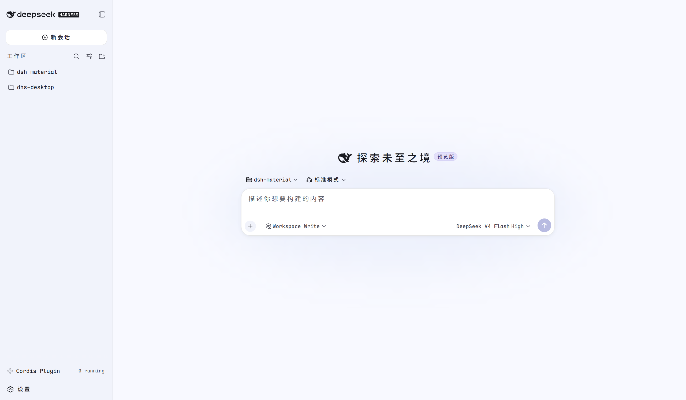

# Material You 皮肤 · DeepSeek Harness

一套遵循 **Google Material You / Material 3 (M3)** 设计规范的 DeepSeek Harness 皮肤。
配色由 **Material Color Utilities 的 HCT 算法** 从种子色推导成色调色板（tonal palette），
字体采用 **Maple Mono NF CN**（带 Nerd Font + 中文的等宽字体）。



---

## 1. 设计要点

| 维度 | 取值 |
| --- | --- |
| 种子色 (seed) | `#3B82F6`（HCT 色相 266.3，tone 55.6 处 chroma 64.2，干净科技蓝） |
| 调色板模型 | HCT（Hue–Chroma–Tone），tone 0–100，非 HSV/HSL |
| 色板数量 | 5 条：primary / secondary / tertiary / neutral / neutral-variant |
| 字体 | Maple Mono NF CN（family name `"Maple Mono NF CN"`，经 System.Drawing 校验） |
| 字重 | 100–800（Thin…ExtraBold）+ 全套斜体 |
| 动效 | M3 emphasized/standard 缓动，支持 `prefers-reduced-motion` |
| 形状 | M3 圆角体系（4/8/12/16/28/full px） |
| 侧栏精修 | 工作区卡片/树状引导线/选中 tonal pill（`src/sidebar.css`）+ 标题后「(可见会话数)」与行尾「最近活动」（`src/sidebar-enrich.js`，订阅客户端工作区 + 会话 store 实时刷新） |

## 2. 种子色与 HCT 色调色板

Material You 的"动态取色"本质：从种子色提取 **色相 (hue)** 与 **彩度 (chroma)**，
再沿 **色调 (tone，即明度 L*)** 轴生成一条 13 级色板。本皮肤种子 `#3B82F6` 推导出：

### primary（主色，chroma 60）

| tone | 10 | 20 | 30 | 40 | 50 | 60 | 70 | 80 | 90 | 95 |
| --- | --- | --- | --- | --- | --- | --- | --- | --- | --- | --- |
| 值 | `#001a42` | `#002e6a` | `#004395` | `#015ac2` | `#3474dd` | `#538ef9` | `#81aaff` | `#adc6ff` | `#d8e2ff` | `#edf0ff` |

### neutral（中性色，用于 surface，chroma 4）

| tone | 4 | 6 | 10 | 12 | 17 | 22 | 40 | 80 | 90 | 94 | 98 |
| --- | --- | --- | --- | --- | --- | --- | --- | --- | --- | --- | --- |
| 值 | `#0d0e11` | `#121316` | `#1b1b1f` | `#1f1f23` | `#292a2d` | `#343538` | `#5e5e62` | `#c7c6ca` | `#e3e2e6` | `#efedf1` | `#faf8fd` |

### neutral-variant（surface-variant / outline，chroma 8）

| tone | 30 | 40 | 50 | 60 | 70 | 80 | 90 |
| --- | --- | --- | --- | --- | --- | --- | --- |
| 值 | `#44474f` | `#5c5e66` | `#75777f` | `#8e9099` | `#a9abb4` | `#c4c6d0` | `#e1e2ec` |

### secondary（次要，chroma 24）与 tertiary（第三，chroma 32）

- secondary：`#505e7d`(40) / `#b8c6ea`(80)
- tertiary：`#77517c`(40) / `#e6b7e9`(80)

> 完整色值见 `src/palette.css`。生成算法（HCT → sRGB）与 Material Color Utilities
> 一致：`#6750A4` 用同算法可复现官方 baseline 色板（primary-40 = `#6750A4`），
> 验证了实现正确性。

## 3. M3 颜色角色 → DSH token 映射

DSH 皮肤通过覆盖 `--dsw-alias-*` / `--dsw-specific-*` 语义 token 生效
（详见 `docs/dsh-skin-development.md`）。下面是核心映射（L=浅色 / D=深色）：

| DSH token | M3 角色 | 浅色 (light) | 深色 (dark) |
| --- | --- | --- | --- |
| `--dsw-alias-bg-base` | surface | `#ffffff` | `#121316` |
| `--dsw-alias-bg-layer-1` | surface-container | `#faf8fd` | `#1f1f23` |
| `--dsw-alias-bg-layer-2` | surface-container-high | `#f5f3f7` | `#292a2d` |
| `--dsw-alias-bg-layer-3` | surface-container-highest | `#f2f0f4` | `#343538` |
| `--dsw-alias-bg-overlay` | surface-variant | `#eff0fa` | `#38393c` |
| `--dsw-alias-brand-primary` | primary | `#015ac2` | `#adc6ff` |
| `--dsw-alias-label-primary` | on-surface | `#1b1b1f` | `#e3e2e6` |
| `--dsw-alias-label-secondary` | on-surface-variant | `#44474f` | `#c4c6d0` |
| `--dsw-alias-label-tertiary` | on-surface-variant | `#44474f` | `#c4c6d0` |
| `--dsw-alias-label-caption` | outline | `#5c5e66` | `#a9abb4` |
| `--dsw-alias-border-l2` | outline-variant | `rgba(27,27,31,.12)` | `rgba(227,226,230,.14)` |
| `--dsw-alias-interactive-bg-hover` | state layer (8%) | `rgba(1,90,194,.08)` | `rgba(173,198,255,.08)` |
| `--dsw-alias-button-primary-fill` | primary | `#015ac2` | `#adc6ff` |
| `--dsw-alias-state-error-primary` | error | `#ba1a1a` | `#ffb4ab` |
| `--dsw-specific-sidebar-fill` | surface-dim | `#fefbff` | `#0d0e11` |
| `--dsw-specific-sidebar-nav-item-active` | secondary-container | `#d8e2ff` | `#004395` |
| `--dsw-specific-sidebar-nav-item-active-accent` | primary-container | `#d8e2ff` | `#004395` |

> ⚠️ `--dsw-specific-sidebar-nav-item-active-accent` 与 `--dsw-alias-button-info-fill`
> 必须保持对比：前者是 `ask_user_question`"推荐"徽章的**背景**，后者是徽章**文字**色。
> 本皮肤取值 primary-container（p90/p30）作背景、primary（p40/p80）作文字，
> 与默认主题"浅/深中性底 + 品牌蓝文字"的关系一致（曾因两者同取 primary 而撞色，已修复）。

完整的 `--dsw-alias-*` 覆盖清单（约 80 个 token × 双外观）在 `src/tokens.mjs`。

> M3 关键语义：surface 用 **neutral** 色板，surface-variant/outline 用 **neutral-variant**，
> primary/secondary/tertiary 独立；深浅两套由"同 roles、不同 tone"天然对应
> （如 primary：light=tone40，dark=tone80）。

## 4. 排印（Maple Mono NF CN）

M3 官方用 Roboto（无衬线），但本皮肤应需求改用 Maple Mono NF CN（等宽）。保留了 M3 的
**字号 / 字重 / 行高 / 字距节奏**，字重按 M3 的 400/500/700 映射到 Maple Mono 的
Regular/Medium/Bold：

| M3 角色 | 字号/行高 | 字重 |
| --- | --- | --- |
| Display Large | 57/64 | 400 |
| Headline Large | 32/40 | 400 |
| Title Large | 22/28 | 400 |
| Title Medium | 16/24 | 500 |
| Body Large | 16/24 | 400 |
| Body Medium | 14/20 | 400 |
| Label Large | 14/20 | 500 |

完整 type scale 与 `--m3-typescale-*` token 见 `src/fonts.css`。

### 字体加载（自托管）

已随包自带 **Regular 字重** woff2（`fonts/MapleMono-NF-CN-Regular.woff2`，约 6.1MB），
`src/fonts.css` 里启用 `@font-face`（`font-weight: 100 800` 声明覆盖全部字重，
未打包的 Medium/Bold 走浏览器合成加粗或系统已安装字体回退）：

```css
@font-face {
  font-family: 'Maple Mono NF CN';
  font-style: normal;
  font-weight: 100 800;
  src: url('/dsh-skin-material-you/fonts/MapleMono-NF-CN-Regular.woff2') format('woff2');
  font-display: swap;
}
```

> ⚠️ **字体 URL 为什么是绝对路径**：皮肤把 `@font-face` 作为内联 `<style>` 注入页面，
> 相对路径 `../fonts/...` 会按页面根路径（`http://127.0.0.1:<port>/fonts/...`）解析而 404
> 始终加载失败；`/plugins` 前缀路由又只 serve 预组装的 `client.js`/`.map`，不提供包内
> 任意静态文件。所以 host 半（`src/index.js`）注册了 `/dsh-skin-material-you` 前缀路由，
> 从包内 `fonts/` 目录 serve 字体，`fonts.css` 用绝对路径引用它。改动 host 半后需
> **重启 `dsh web`** 才会挂上该路由（皮肤 client 半改动刷新即生效）。

> 如需更忠实的 Medium/Bold 字重，把对应 TTF 用 fontTools 转 woff2 放入 `fonts/`
> 并补对应 `@font-face` 规则（每份约 6MB）。

## 5. 文件结构

```
packages/skin-material-you/   # melon 单仓库中的一个包
├── package.json        # dsh.bundle.patch + dsh.client 声明（标准插件形态）
├── cordis.patch.yml    # 自带 patch：insert 皮肤行（bundle 层）
├── build.mjs           # 构建脚本：tokens.mjs + 三份 CSS + sidebar-enrich.js → lib/client.js
├── README.md           # 本文档
├── demo.png            # 主题展示截图
├── LICENSE             # MIT
├── docs/
│   └── dsh-skin-development.md   # DSH 皮肤开发参考文档
├── fonts/              # 自托管 Maple Mono Regular woff2（6.1MB）
├── src/                # 源文件
│   ├── tokens.mjs      # M3 色调色板 → DSH --dsw-* 覆盖（source of truth）
│   ├── fonts.css       # Maple Mono @font-face + M3 type scale / shape / motion token
│   ├── palette.css     # 原始 HCT 色板（参考/文档）
│   ├── sidebar.css     # 侧栏工作区列表精修 + 注入元信息的样式（标题后计数、行尾时间）
│   ├── sidebar-enrich.js  # 客户端装饰：标题后加「(n) 可见会话数」、行尾加「最近活动」；优先订阅客户端工作区 + 会话 store（实时），无服务时回落 host 路由
│   ├── client.js       # 源版插件体（apply/overrideTokens/register/注入 CSS）
│   ├── client.d.ts
│   └── index.js / index.d.ts   # host 入口：/dsh-skin-material-you 下 serve fonts/ + api/workspaces（构建时复制进 lib/）
├── scripts/
│   ├── smoke.mjs       # 按 web shell 方式加载 lib/client.js，驱动 apply/dispose
│   ├── dom-check.mjs   # 生成自包含走查页（真实 DSH 工作区行样式 + 真实 bundle），仅开发用
│   └── dom-check.page.js  # 走查页里的侧栏复刻与 24 条断言（浏览器里跑，scripts/ 不入包）
└── lib/       # 构建产物（DSH 实际加载）——不入版本控制，由 build.mjs 产出
    ├── index.js  # host 侧 no-op 插件入口（exports: name/apply）
    ├── index.d.ts / client.d.ts
    └── client.js     # 浏览器侧 bundle（__ModuleLoader__.load 格式，内联 tokens+CSS）
```

### 侧栏工作区元信息的两个数据源

原生工作区行只渲染「文件夹图标 + 名称」，`src/sidebar-enrich.js` 补上两件事：**标题后的
「(n)」可见会话数**与**行尾的「最近活动」时间**。

`n` 的口径是「展开这个工作区后实际能看到几行」，因此必须套用树自己的可见性谓词
（ui-workspace 的 `tree.ts` `sessionVisible()`）：排除**全局归档**、排除 **subagent 来源**、
排除 **blank（新建后从未发过消息）**会话。只扣归档集仍会多算后两类；直接数 `sessionIds`
则会显示全部历史（每行几十个），与展开后看到的行数对不上。数据源按顺序尝试：

| | 来源 | 刷新时机 |
| --- | --- | --- |
| 1 | 客户端工作区服务 `ctx.get("workspaces")` **+ 客户端会话服务 `ctx.get("sessions")`**（前者给 `sessionIds` 与全局归档集，后者给每个会话的 `blank`/`origin`） | 订阅推送：**归档或新建一提交，计数立即变**，不轮询 |
| 2 | host 半的只读路由 `GET /dsh-skin-material-you/api/workspaces` | 60s 轮询；某个服务缺失或首帧未就绪时的兜底 |

会话服务是关键：`blank`/`origin` 只存在于客户端会话列表里，`storages/workspace.json` 里没有
（会话体是 zstd 压缩的）。所以**路由兜底只能给出「扣掉归档」的近似值**，会在注释里注明这一点，
而不是假装它是精确值。两个服务都用 `ctx.get` **可选**获取：拿不到就回落，都拿不到就不加注解——
绝不影响主题本身（`apply` 里还包了一层 try/catch）。计数是标题的兄弟节点（`title` 之后），
所以标题文本仍是纯名称，标签匹配不受影响；DOM 是原地更新的，React 重渲染后也能幂等地补回来。

> 注意：计数小不代表数据丢了。若某工作区历史上被归档过大量会话，它可能只显示 `(0)` 或 `(1)`——
> 那是真实的可见行数；需要看到更多时，请在侧栏切换归档筛选或取消归档。

### DOM 走查（开发用）

`node scripts/dom-check.mjs`（先 `node build.mjs`，需要本地 DSH checkout，可用 `$DSH_DIR` 覆盖）
会生成一个自包含页面：它内联真实 bundle，并从 `$DSH_DIR/packages/client/ui-workspace/lib/client.js`
抽出**真实的工作区行样式**、从 `apps/web/dist` 抽出真实 token，再复刻一棵侧栏 DOM 来跑
`scripts/dom-check.page.js` 里的断言（计数位置/不靠右/标题省略号/归档推送刷新/subagent 与 blank
排除/会话列表缺席时不倒数/双服务晚注册升级/历史型账号计数/回落路由/卸载清理）。
用浏览器打开生成的 `.dom-check.html` 即可看到逐条 PASS/FAIL；`?preview=1` 是纯预览模式。

## 6. 插件形态（参考 dsh-ads）

插件形态参考了 [Nagi-ovo/dsh-ads](https://github.com/Nagi-ovo/dsh-ads) 仓库：

- **`dsh.bundle.patch: "./cordis.patch.yml"`** —— 声明本包是一个 bundle patch 层；
  `dsh plugin add` 后会自动把包名加进 profile 的 `dsh.profile.bundles`，无需手动编辑 profile。
- **自带 `cordis.patch.yml`** —— 用 `insert` 把皮肤行挂进加载列表：
  ```yaml
  - insert:
      - id: ui-skin-material-you
        name: 'dsh-skin-material-you'
  ```
- **`exports["./client"]` 为简单字符串**，指向 `lib/client.js` 浏览器 bundle。

### 两层 inject（易混淆，务必分清）

| 位置 | 内容 | 作用 |
| --- | --- | --- |
| `package.json` 的 `dsh.client.inject` | **包名**数组 | 构建 `window.__DSH_BOOT__` 引导图的包级加载顺序 |
| `lib/client.js` 的 `exports.inject` | **服务名**数组 | 浏览器 cordis 服务依赖（fiber 激活前等待） |

> ⚠️ 二者不能混用：`exports.inject` 若写成包名，浏览器 cordis 会永远等不到该
> "服务"，条目卡 `pending`，`web boot` 抛 `did not activate` 错误。
> 本皮肤 `exports.inject = ['theme']`（`theme` 是 ui-theme 提供的服务名）。

## 7. 安装到 DSH

DSH 的 `dsh plugin` 是 pnpm 转发器，支持本地路径、GitHub 等 pnpm 依赖来源：

```bash
# 方式一：从 GitHub 安装（仓库根即插件包）
dsh plugin --profile web add dsh-skin-material-you

# 方式二：从本仓库目录安装（file: 依赖；发布到 npm 后也可直接加包名）
dsh plugin --profile web add "file:/path/to/melon/packages/skin-material-you"
```

安装后：
- 包被自动加入 `profiles/web/package.json` 的 `dsh.profile.bundles`
- 自带 `cordis.patch.yml` 把 `ui-skin-material-you` 行插进加载列表
- 重启 `dsh web` 生效：`system` 偏好下两种外观均为 Material You 配色；
  设置 → 外观里可选 `material-you-light` / `material-you-dark` 固定主题

> 💡 GitHub 安装会走包内 `prepare` 构建流程，pnpm 默认阻止构建脚本——若提示
> `Ignored build scripts`，在 `profiles/web/pnpm-workspace.yaml` 的 `allowBuilds`
> 里加入包名后重新执行即可（`lib/` 已随 npm 包发布，无需本地构建）。

卸载：`dsh plugin --profile web remove dsh-skin-material-you`

验证：`dsh --profile web --dump-config` 应看到皮肤行，且标记来源为
`# == dsh-skin-material-you`（bundle 自带 patch 层）。

## 8. 已知限制

- **第三方主题是扩展点不是产品**：DSH 不校验覆盖是否完整；本皮肤已尽量覆盖全部
  `--dsw-alias-*` 与 `--dsw-specific-*`，但若上游新增 token 需同步补。
- **只随包携带 Regular 字重**：Medium/Bold 走浏览器合成或系统字体回退（见 §4）。
- 若要更换种子色，改 `src/tokens.mjs` 里的调色板常量（或重新跑 HCT 生成器），
  并同步 `src/palette.css`，再 `node build.mjs` 重新构建 `lib/client.js`。

## 9. 换种子色

想换主题色，改步骤：

1. 用 HCT 生成器（material-color-utilities 或 `src/palette.css` 头部的注释算法）从新种子
   生成 primary/secondary/tertiary/neutral/neutral-variant 五条色板。
2. 替换 `src/tokens.mjs` 里 `NEUTRAL`/`VARIANT`/`PRIMARY`/`SECONDARY`/`TERTIARY`
   常量与 `ERROR`。
3. 同步 `src/palette.css` 的参考值。
4. 重新构建浏览器 bundle：`node build.mjs`（生成 `lib/client.js`）。
